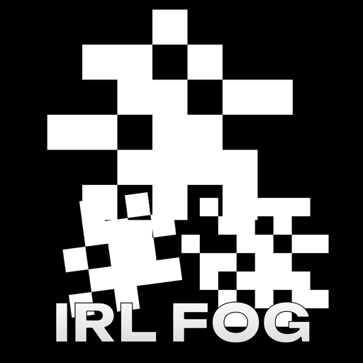
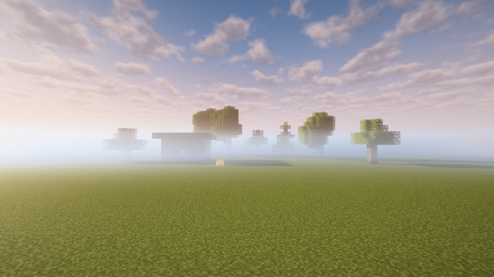
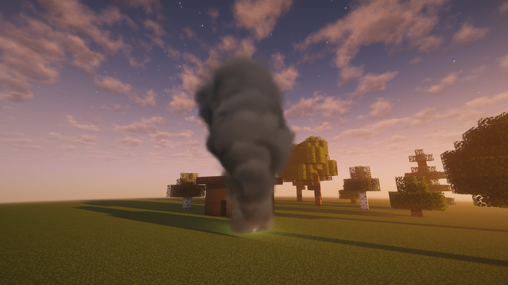
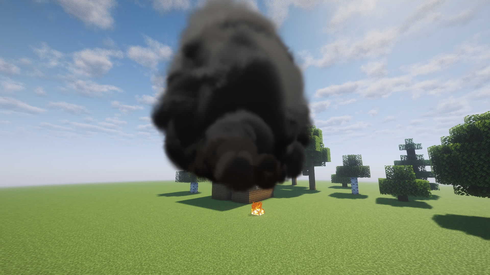
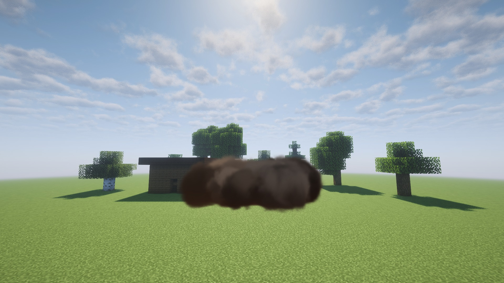
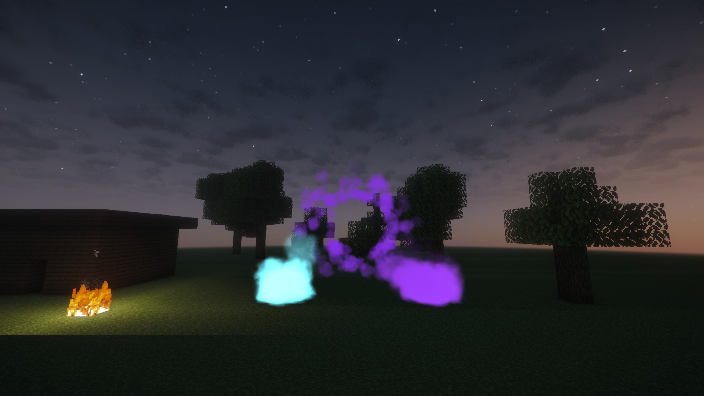
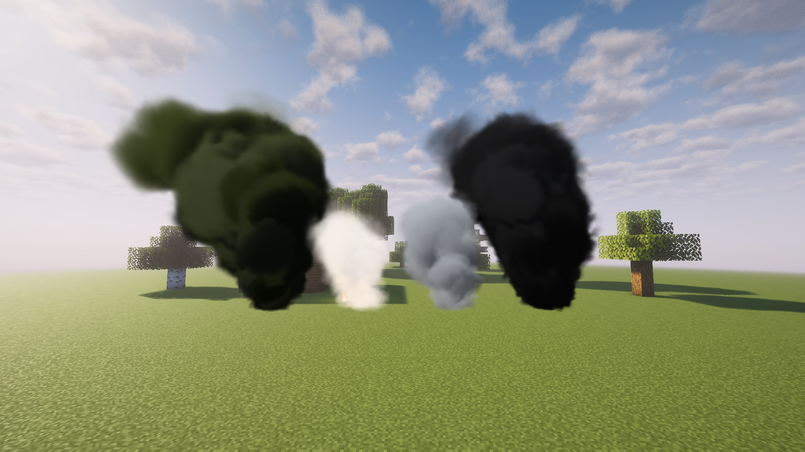

# IRLfog: Volumetric Smoke & Fog

An addon for [IRLights](https://modrinth.com/mod/irlights) (IRL Redactor) that renders real volumetric smoke and fog in Minecraft. It does not use vanilla particles. Smoke is raymarched in 3D, has physics and lighting, and can be animated with keyframes. It is made for cinematic shots.

Fabric · Minecraft 1.21.11 · client-side only

| | |
|---|---|
|  |  |
|  |  |
|  |  |

*Screenshots: Iris + Complementary Unbound, quality profile Ultra.*

## Features
- Raymarched volumetric smoke; works with Iris shader packs
- 50+ presets: smoke, campfire, building fire, explosion, fog, steam, magic and more
- Puff sources (box, sphere, point, disc, ring, line) and static fog fields
- Physics: buoyancy, wind, turbulence, vortex and attractor fields, block collisions, reaction to entities
- Lit by the sun, the moon, block light and IRLights lamps
- Keyframe animation synced to the IRL Redactor scene time
- Quality profiles from Low to Cinematic, adaptive quality, LOD by distance

Open the IRL Redactor light editor (**J**). The **Smoke** window opens next to it. The UI is in Russian for now.

## Requirements
- Fabric Loader, Fabric API
- [IRLights](https://modrinth.com/mod/irlights) (IRL Redactor; bundles IRL Core)

## Building
IRLights is not published to Maven, so the build reads it from `libs/`:

1. Put `irl-redactor-1.1.8+mc1.21.11.jar` from IRLights into `libs/`.
2. From that jar's `META-INF/jars/`, copy `irl-core-1.1.7.jar` and the `imgui-java-*-1.89.0.jar` files into `libs/` too.
3. Run `./gradlew build`. The mod jar is written to `build/libs/`.

Client game tests (screenshots and performance) run with `IRLFOG_TEST=look|perf|gui|iris|shots ./gradlew runClientGameTest`.

## License
[MIT](LICENSE)
